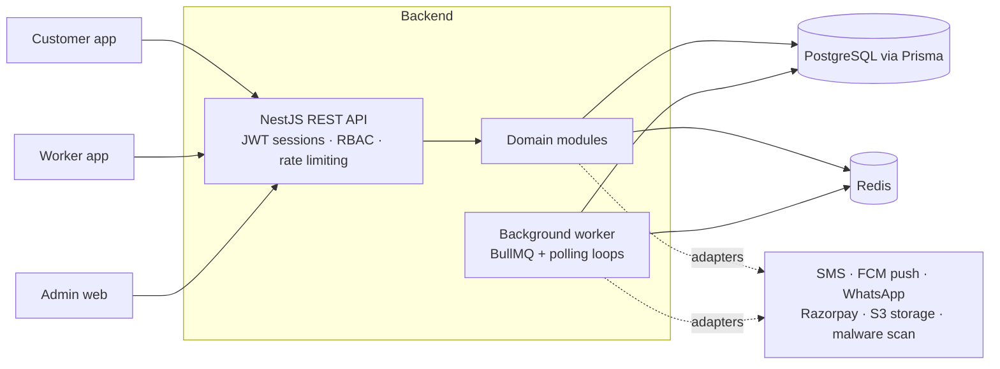
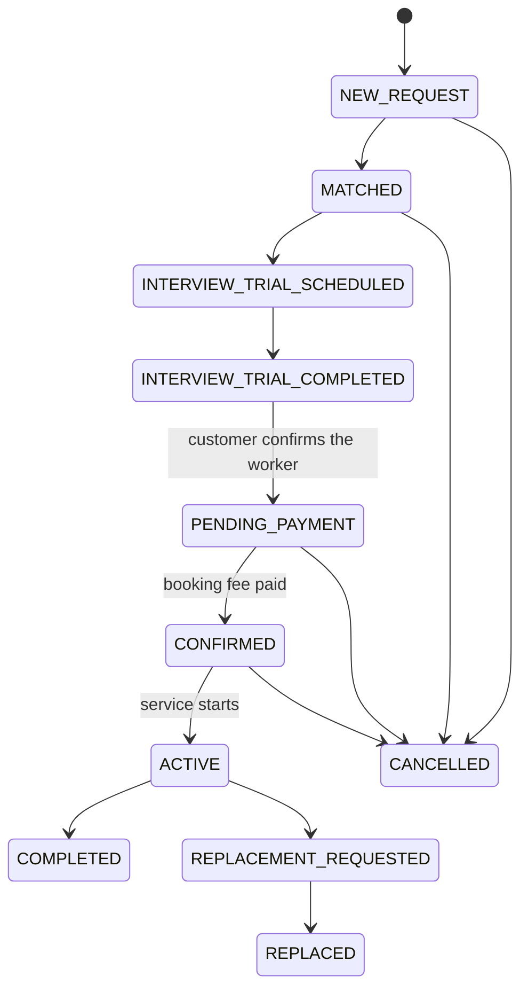

<div align="center">

# SevaNest Backend

**The API behind a household-workforce marketplace.**<br>
Customers find and book verified workers, workers manage their profile and jobs, and operations teams run verification, matching, payments and support.

[](https://github.com/syedvpd/sevanest-backend/actions/workflows/ci.yml)


[Getting started](#getting-started) · [API](#api) · [Architecture](#architecture) · [Docs](docs/DEVELOPMENT.md) · [Customer app handoff](docs/qa/customer-app-integration-handoff.md) · [Issues](https://github.com/syedvpd/sevanest-backend/issues)

</div>

---

## Contents
[Overview](#overview) · [Getting started](#getting-started) · [API](#api) · [Architecture](#architecture) · [Capabilities](#capabilities) · [Testing and quality](#testing-and-quality) · [Production and security](#production-and-security) · [Repository map](#repository-map) · [Contributing](#contributing) · [License](#license)

## Overview
SevaNest connects households with vetted domestic workers (maids, cooks, drivers, caregivers and similar roles).

| Audience | What the API gives them |
|---|---|
| **Customers** (mobile app) | OTP login, profile and addresses, worker search and cards, shortlist, interviews or trials, booking and payment of the booking fee, attendance view, ratings, support |
| **Workers** (mobile app) | OTP login, step-by-step onboarding, KYC documents, availability, job offers, interviews, attendance, ratings received |
| **Operations** (admin web) | Role-based admin accounts, worker verification queue, matching, bookings, replacements, payments, support tickets, reports, audit trail |

It is a **NestJS modular monolith**: one deployable API plus one background worker, with PostgreSQL as the only source of truth. The mobile apps and the admin web client live in other repositories.

> **Status.** Backend implementation and automated tests are complete for the approved scope. Real SMS, payment, push and storage providers, mobile-app integration, staging and production operations are **not yet verified** (see [Production and security](#production-and-security)).

## Getting started
The backend runs as one API process plus one background worker, with PostgreSQL and Redis. Developers set it up with Docker or directly on the host following the internal guide: [docs/LOCAL_DEVELOPMENT.md](docs/LOCAL_DEVELOPMENT.md). Configuration is read from environment variables; [`.env.example`](.env.example) lists every setting.

Once a deployment is running, readiness is at `/health/ready`, interactive API docs at `/docs` and the OpenAPI document at `/docs/openapi.json` (enabled by `SWAGGER_ENABLED`).

## API
| | |
|---|---|
| Base path | `/api/v1` (health probes at `/health/live` and `/health/ready`) |
| Explore | Swagger UI at `/docs`, OpenAPI JSON at `/docs/openapi.json` (enabled by `SWAGGER_ENABLED`) |
| Auth | Customers and workers: mobile OTP → short-lived JWT access token plus single-use rotating refresh token, checked against a server-side session on every request. Admins: email and password, then permission-based roles |
| Lists | `{ "data": [...], "meta": { "page", "limit", "total" } }`, defaults page 1, limit 20, maximum 100 |
| Errors | `{ "code", "message", "details?", "requestId" }` with stable machine-readable codes (for example `OTP_INVALID`, `WORKER_NOT_FOUND`) |
| Safe retries | Optional `Idempotency-Key` header on unsafe endpoints; `ETag` / `If-Match` on admin edits |

Integration guides for the app teams: [customer app handoff](docs/qa/customer-app-integration-handoff.md) · [customer API answers](docs/qa/customer-app-api-gaps.md) · [screen-to-API traceability, customer](docs/qa/customer-screen-api-traceability.md) and [worker](docs/qa/worker-screen-api-traceability.md). Per-module notes live in `src/modules/<name>/README.md`.

## Architecture

* **PostgreSQL is authoritative.** Redis and BullMQ hold queues, throttling counters, OTP state and heartbeats only; losing Redis never loses business data.
* **Synchronous work** (requests) writes state and an outbox row in one transaction. **Background work** (the `worker` process, or embedded with `EMBEDDED_WORKERS=true`) delivers notifications, recovers lost payment callbacks, sweeps expired offers and re-checks verification. Loops claim rows atomically, so several replicas are safe.
* **Providers are adapters** chosen by configuration (`disabled`, `fake` or `memory` for local and tests; real vendors for deployment). Fake adapters are refused in production.

<details>
<summary>Booking lifecycle</summary>


Interviews and trials are their own entity (one open session per booking) that moves the booking between the scheduled and completed states. A worker cannot be booked for overlapping hours.
</details>

## Capabilities
Each item is implemented and covered by automated tests. Items marked *needs credentials* run against fakes locally and have not been exercised with the real vendor.

| Area | What exists | Module docs |
|---|---|---|
| Identity and access | OTP login, admin login, refresh rotation, sessions, RBAC, throttling, lockout | [auth](src/modules/auth/README.md) · [users](src/modules/users/README.md) |
| Onboarding | Customer profile and addresses; worker profile, categories, availability, photo, submit, progress endpoint | [customers](src/modules/customers/README.md) · [workers](src/modules/workers/README.md) |
| Catalogue and availability | Service categories and engagement types, service areas (optional map centre), worker windows | [categories](src/modules/service-categories/README.md) · [availability](src/modules/availability/README.md) |
| Search and matching | Worker cards, filters, shortlist, staff matching, slot lookup | [search](src/modules/search/README.md) · [matching](src/modules/matching/README.md) |
| Interviews and bookings | Booking lifecycle, interview and trial workflow, busy-hours rules | [booking](src/modules/booking/README.md) |
| Payments | Booking fee, webhook verification, reconciliation, refunds. Razorpay *needs credentials* | [payment](src/modules/payment/README.md) |
| KYC and verification | Documents in private storage, signed links, review queue, re-checks. S3 and malware scanning *need credentials* | [verification](src/modules/verification/README.md) |
| Attendance and replacement | Per-day attendance, replacement requests and linked bookings | [attendance](src/modules/attendance/README.md) · [replacement](src/modules/replacement/README.md) |
| Notifications | Outbox, templates, in-app inbox; FCM push, SMS (MSG91, Twilio) and WhatsApp *need credentials* | [notifications](src/modules/notifications/README.md) |
| Ratings, support, reports | Ratings with moderation, tickets, 12 reports with CSV export | [ratings](src/modules/ratings/README.md) · [support](src/modules/support/README.md) · [reports](src/modules/reports/README.md) |
| Audit and operations | Audit log, security events, admin alerts, readiness endpoint | [DEVELOPMENT.md](docs/DEVELOPMENT.md) |

**Blocked by product decisions** (the safe behaviour is documented in each): price guidance data, budget filtering, weekday availability, customer profile photo, map boundaries, refund and cancellation-fee policy. See [open questions](docs/project-intelligence/OPEN_QUESTIONS.md) and the [closure register](docs/qa/closure-register.md).

## Testing and quality
Run the same gates CI runs ([`ci.yml`](.github/workflows/ci.yml)):
```bash
npx prisma validate
npm run format:check
npm run lint
npm run typecheck
npm run build
```
```bash
npm test
npm run test:e2e
npm run test:integration
```
Integration tests need a **disposable database whose name ends in `_test` or `_ci`**; they refuse any other name. Point them at one with `TEST_DATABASE_URL`, and start with a fresh, migrated database each full run. Check migration consistency with `npx prisma migrate deploy` on an empty database followed by `npx prisma migrate diff --from-config-datasource --to-schema prisma/schema.prisma --exit-code`. Container check: `docker build --target runtime -t sevanest-backend .`.

| Evidence | Latest completed run (2026-10-13, local, fake providers) |
|---|---|
| Unit | 29 suites, 270 tests |
| End to end | 2 suites, 27 tests |
| Integration | 47 suites, 818 tests |
| Docker | image builds; the compose stack starts and passes its readiness check |

These are local automated results. They are not evidence of real-provider, staging or production behaviour, mobile-app integration, or any capacity target. A local load experiment found worker search to be the first bottleneck; no capacity figure is promised.

## Production and security
Production readiness is **not claimed**. What exists, and what still needs the owner:

| Topic | State | Where |
|---|---|---|
| Configuration and secrets | Environment only; production start-up validation rejects placeholders, memory/fake providers and missing proxy settings | [`.env.example`](.env.example) · [DEVELOPMENT.md](docs/DEVELOPMENT.md) |
| Admin bootstrap | One-off command, never part of seeding in production | [DEVELOPMENT.md](docs/DEVELOPMENT.md) |
| Real providers | SMS, push, storage, payments built behind adapters; credentials and live tests outstanding | [production readiness](docs/qa/production-readiness-matrix.md) |
| Migrations | Reviewed SQL, `prisma migrate deploy` only; never reset or drop | [database guide](docs/DATABASE_MIGRATION.md) |
| Backups and restore | Scripts in [`scripts/db`](scripts/db) tested locally; scheduled backups and a restore drill are the operator's | [database guide](docs/DATABASE_MIGRATION.md) · [runbook](docs/qa/OPERATIONS_RUNBOOK.md) |
| Deployment | [`render.yaml`](render.yaml) blueprint (API plus worker); TLS, monitoring and alerting are not verified | [runbook](docs/qa/OPERATIONS_RUNBOOK.md) |
| Abuse protection | Per-IP and per-mobile OTP limits, admin lockout, global throttling | [API security audit](docs/qa/API_SECURITY_AUDIT.md) |
| Sensitive data | KYC files in a private bucket with short-lived signed links; documents and contact details never appear in customer-facing responses | [RBAC matrix](docs/qa/RBAC_MATRIX.md) |
| Payment webhooks | Signature verified, duplicate and out-of-order safe | [payment](src/modules/payment/README.md) |

**Reporting a vulnerability.** No public security contact or policy file is published yet. Do not open a public issue; contact the repository owner privately.

## Repository map
| Path | Contents |
|---|---|
| [`src/`](src) | `modules/` (business domains), `common/`, `infrastructure/`, `integrations/` (provider adapters), `main.ts` (API), `worker.ts` (background worker) |
| [`prisma/`](prisma) | schema and reviewed SQL migrations |
| [`test/`](test) | integration and e2e tests, shared helpers |
| [`scripts/`](scripts) | database backup, restore and rebuild; local tooling |
| [`docs/`](docs) | [developer reference](docs/DEVELOPMENT.md), [local development](docs/LOCAL_DEVELOPMENT.md), [database guide](docs/DATABASE_MIGRATION.md), [specifications](docs/project-specifications), [QA evidence and handoffs](docs/qa), [decisions and open questions](docs/project-intelligence) |
| `docker-compose.yml`, `Dockerfile`, `render.yaml` | local stack definition, container image, deployment blueprint |

## Contributing
This is a private project. Changes follow the repository's existing workflow:
1. Branch from `main`; keep each pull request focused.
2. Schema changes only through a reviewed migration (`prisma migrate dev`); never edit an applied migration.
3. Add or update tests with the change; the gates in [Testing and quality](#testing-and-quality) must pass.
4. Business rules come from the [specifications](docs/project-specifications) and recorded [decisions](docs/project-intelligence/DECISION_INDEX.md); an unclear rule becomes an entry in [open questions](docs/project-intelligence/OPEN_QUESTIONS.md), not a guess.
5. Never commit `.env` files, keys, service-account files or personal data.

Report bugs and requests in [GitHub Issues](https://github.com/syedvpd/sevanest-backend/issues) with steps to reproduce and the `requestId` from the error response.

## License
Proprietary. `package.json` declares `UNLICENSED` and the repository has no `LICENSE` file, so all rights are reserved.
